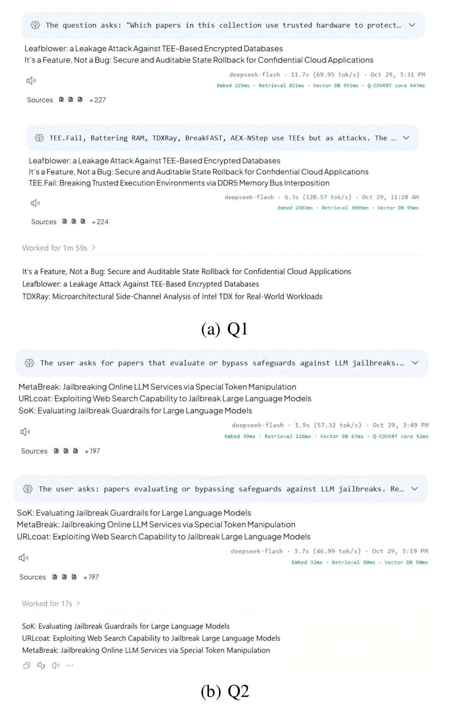

# Building and Running AnythingLLM with Q-COVERT

This guide describes the local development setup in this repository. AnythingLLM connects to the Q-COVERT query service; the query service connects to the Q-COVERT storage service.

```text
Browser → AnythingLLM → qcovert_query → qcovert_storage
```

The application is self-contained under `anything-llm/`, separately from the outer
research builds. Its Node dependencies, Python environment, CMake outputs and
service databases are created within this application directory. Start here:

```bash
cd /path/to/Q-COVERT/anything-llm
```

Replace `/path/to/Q-COVERT` with your checkout location. Each command block below
states its working directory. All application setup and build commands belong
here, rather than in the outer repository's installation/build flow.

## 1. Prerequisites

Use Linux on an x86-64 CPU with AVX2 support, a C++17 compiler, CMake 3.20 or later, Python 3, Node.js 18 or later, and Yarn. Install the system dependencies on Ubuntu/Debian:

```bash
sudo apt update
sudo apt install -y build-essential cmake pkg-config libssl-dev \
  python3 python3-venv python3-pip curl
```

For a fresh AnythingLLM checkout, install its dependencies and initialize its application database:

```bash
cd /path/to/Q-COVERT/anything-llm
yarn install
yarn setup
```

`yarn setup` runs the Prisma setup and migrations. On an existing installation, keep the existing application database and environment configuration; this step is not required for every startup.

## 2. Prepare Python and build Q-COVERT

Build the bundled vector database in its own directory:

```bash
cd /path/to/Q-COVERT/anything-llm/Q-COVERT-VectorDB
python3 -m venv .venv
./.venv/bin/python -m pip install --upgrade pip
./.venv/bin/python -m pip install numpy faiss-cpu
./.venv/bin/python -c 'import faiss, numpy; print("Faiss and NumPy are available")'
cmake -S . -B build -DCMAKE_BUILD_TYPE=Release
cmake --build build --target qcovert_storage qcovert_query -j"$(nproc)"
```

The executables are `Q-COVERT-VectorDB/build/qcovert_storage` and
`Q-COVERT-VectorDB/build/qcovert_query` relative to `anything-llm/`. The private
Python environment is `Q-COVERT-VectorDB/.venv/`. These commands build only the
application's bundled source under `Q-COVERT-VectorDB/core/`; no outer research
build or shared benchmark dataset is required.

## 3. Configure AnythingLLM

For development, the server reads `server/.env.development`. On a new installation, create it from `server/.env.example` if it does not already exist. Set or update these entries:

```dotenv
VECTOR_DB="qcovert"
QCOVERT_ENDPOINT="http://127.0.0.1:8080"
QCOVERT_API_KEY="your-qcovert-api-key"
QCOVERT_COLLECTION_PREFIX="anythingllm_"
QCOVERT_CANDIDATE_FACTOR="1"
QCOVERT_REQUEST_TIMEOUT_MS="30000"
QCOVERT_GENERATION_TIMEOUT_MS="1800000"
QCOVERT_GENERATION_POLL_MS="1000"

EMBEDDING_ENGINE="native"
EMBEDDING_MODEL_PREF="MintplexLabs/multilingual-e5-small"

LLM_PROVIDER="openai"
OPEN_AI_KEY="your-openai-api-key"
OPEN_MODEL_PREF="gpt-4.1-nano"
```

Generate a private Q-COVERT key once, for example:

```bash
python3 -c 'import secrets; print(secrets.token_hex(32))'
```

Copy the printed string into `QCOVERT_API_KEY` in `server/.env.development`,
replacing `your-qcovert-api-key`. This is a key you create for the connection
between AnythingLLM and `qcovert_query`; it is not an OpenAI key. Terminal 2
loads this same file, so both processes use the same value. If you change it,
restart both processes. Replace `your-openai-api-key` in `OPEN_AI_KEY` with your
OpenAI API key for GPT chat. `server/.env.development` is ignored by Git; keep
real keys out of committed files. If the file already contains `VECTOR_DB` or
other settings, update those lines instead of adding duplicate entries.

Q-COVERT requires 384-dimensional embeddings. Existing collections must be queried with the same embedding model and preprocessing used when they were built. The existing SP2026 collections use `MintplexLabs/multilingual-e5-small`; changing the model requires rebuilding the vectors and collection.

## 4. Choose the database directories

The examples below create a new application database using these directories,
relative to `anything-llm/Q-COVERT-VectorDB/`:

| Service | Local data directory |
| --- | --- |
| Storage | `./storage` |
| Query | `./qcovert-data` |

An existing imported corpus is optional. To reuse one, explicitly pass its
matching storage and query directories with `--root` and use the corresponding
AnythingLLM application database. New local directories start without imported
papers or workspaces. Existing external installations are not selected by default.

Use only one query process for a given query data directory. Keep the matching storage and query directories together: they contain the two parts of the same database state.

## 5. Start the services

Open three terminals and keep each command running.

### Terminal 1: Q-COVERT storage

```bash
cd /path/to/Q-COVERT/anything-llm/Q-COVERT-VectorDB
./build/qcovert_storage \
  --port 19091 \
  --root ./storage \
  --worker-threads 16
```

### Terminal 2: Q-COVERT query service

The following loads the existing local development configuration into the shell so the query service receives `QCOVERT_API_KEY`. Use this only with a trusted, shell-compatible environment file.

```bash
cd /path/to/Q-COVERT/anything-llm/Q-COVERT-VectorDB
set -a
source ../server/.env.development
set +a
./build/qcovert_query \
  --port 8080 \
  --root ./qcovert-data \
  --storage-host 127.0.0.1 \
  --storage-port 19091 \
  --worker-threads 16 \
  --python ./.venv/bin/python \
  --faiss-threads 0 \
  --kmeans-niter 25 \
  --kmeans-nredo 2
```

Wait for the query service to report that it is listening on port `8080`. The service binds to a network interface, so restrict access to its port appropriately for your deployment.

### Terminal 3: AnythingLLM

```bash
cd /path/to/Q-COVERT/anything-llm
yarn dev
```

Open **http://localhost:3000**. The development server normally listens on port `3001`, and the document collector on port `8888`.

## 6. Check the connection and use a workspace

Load the same local configuration in a new shell, then check the query service:

```bash
cd /path/to/Q-COVERT/anything-llm
set -a
source server/.env.development
set +a
curl --noproxy '*' -sS \
  -H "Authorization: Bearer ${QCOVERT_API_KEY}" \
  http://127.0.0.1:8080/v1/health
```

The response should contain `"status":"ok"` and `"dimension":384`. In AnythingLLM, check that **Settings → Vector Database** is set to **Q-COVERT**, then open a workspace and ask a question.

With the `anythingllm_` prefix, the workspace slug `papers` maps to the collection `anythingllm_papers`. Previously imported workspaces and vectors are available only when the matching AnythingLLM application database and both Q-COVERT data directories are explicitly reused. Directly imported vectors can be searchable even when the front-end document list does not show individual uploads.

For a new workspace, add documents through the front end. The first upload may take longer because Q-COVERT builds and activates an initial generation. For the existing prepared PDF corpus, see the PDF preparation and import section of [Q-COVERT-VectorDB/README.md](Q-COVERT-VectorDB/README.md) and the scripts under `Q-COVERT-VectorDB/scripts/`. Dataset files and runtime databases are intentionally excluded from Git.

The optional paper-PDF agent reads `Q-COVERT-VectorDB/pdf-corpus-v1/source/`
by default. Set `QCOVERT_PDF_SOURCE_DIR` in `server/.env.development` to an
absolute directory when reusing a corpus elsewhere.

The current Q-COVERT adapter does not remove individual vectors when a single document is deleted from AnythingLLM. Deleting an entire workspace namespace removes its collection; check the Q-COVERT README before rebuilding or deleting data.

## 7. Stop safely

Stop the processes in this order:

1. Press `Ctrl+C` in the AnythingLLM terminal.
2. Press `Ctrl+C` in the `qcovert_query` terminal and wait for `graceful shutdown complete`.
3. Press `Ctrl+C` in the `qcovert_storage` terminal and wait for its `graceful shutdown complete` message.

The query service checkpoints its active ORAM state during shutdown. Allow it to finish before stopping storage.

## 8. Troubleshooting

- **AnythingLLM cannot connect:** confirm that both Q-COVERT services are running, `QCOVERT_ENDPOINT` points to port `8080`, and the two services use the same API key.
- **Python cannot import Faiss or NumPy:** install them in the environment passed to `qcovert_query --python` and rerun the import check in section 2.
- **An existing workspace appears empty:** check the workspace slug, `QCOVERT_COLLECTION_PREFIX`, and both service data directories. Starting with new `--root` directories creates a separate empty database.
- **Embedding dimension or model mismatch:** select the same 384-dimensional embedding model used to create the collection.
- **The model cannot answer:** check the chat model provider and its API credentials separately from the Q-COVERT connection.

For additional service parameters and API details, see [Q-COVERT-VectorDB/README.md](Q-COVERT-VectorDB/README.md).

## 9. Application evaluation

### Integration and setup

We implement Q-COVERT-CO as a vector database service and integrate it into
AnythingLLM for document question answering. The evaluation corpus contains
more than 200 papers from IEEE S&P 2026. We split the papers into chunks and
encode them with `multilingual-e5-small`, producing more than 40,000 vectors
of 384 dimensions.

At query time, AnythingLLM embeds the question and sends the query vector to
the Q-COVERT-CO client. The client performs private search with the storage
server and returns the retrieved results as context for the LLM. We compare
this workflow with AnythingLLM using its default vector database, LanceDB,
and with ChatGPT given direct access to the documents as a reference.

### Results

We ask two questions:

- **Q1:** Which papers use trusted hardware to protect sensitive data during
  computation?
- **Q2:** Which papers evaluate or bypass safeguards against LLM jailbreaks?



Responses to (a) Q1 and (b) Q2. In each panel, from top to
bottom: AnythingLLM with Q-COVERT-CO, AnythingLLM with its default LanceDB,
and ChatGPT with direct access to the documents (reference).

For Q1, all three workflows return the same two papers, while the LanceDB
and ChatGPT workflows each additionally return a paper that attacks TEEs.
For Q2, all three workflows return the same three papers.

Retrieval through Q-COVERT-CO takes tens to hundreds of milliseconds per
answer. LLM generation dominates response time and varies considerably
across runs, so the two AnythingLLM workflows are similarly responsive in
practice. These examples show that Q-COVERT-CO can serve as a drop-in private
retrieval backend for document question answering.

Q-COVERT-CO protects retrieval only. End-to-end privacy additionally requires
a local or private LLM, which AnythingLLM supports.
